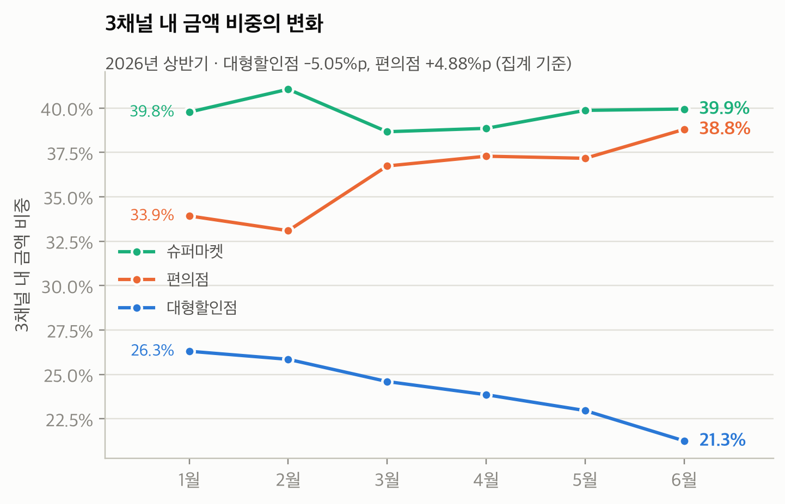
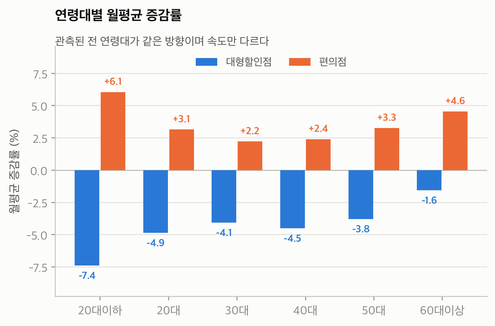
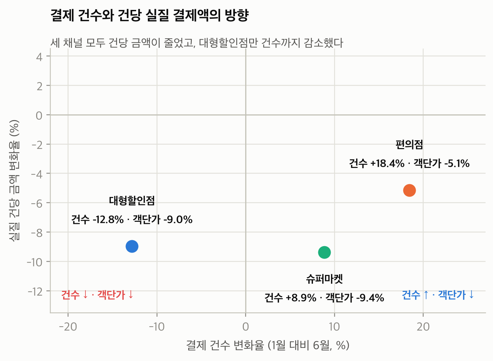

# BC 장보기 핏

### 소비데이터 기반 공동 혜택 운영 플랫폼 제안

AI금융빅데이터플랫폼 소비데이터 활용 아이디어 공모전에서 **ECHOP** 팀은 대형할인점·슈퍼마켓·편의점의 소비 비중 변화를 분석하고, 발급사와 가맹점이 장보기 혜택을 함께 설계하는 방안을 제안했습니다. 참여 매장에서 여러 번 결제한 소액 거래도 월 단위로 합산하고, 고객은 다음 달에 적용할 혜택 패키지를 직접 선택하는 구조입니다.

| 대형할인점 비중 | 편의점 비중 | 6월 채널 비중 예측 MAE | 가상 혜택 차이 |
| --- | --- | --- | --- |
| 26.30% → 21.25% | 33.93% → 38.80% | 1.544%p | 직전 월 기준 대비 프로필당 +3.16원 |



*제공 자료에서 각 월의 세 채널 금액 합계를 분모로 계산했습니다. 월별 계절성은 제거하지 않았습니다.*

## 1. 연구 질문

장보기 소비가 여러 채널에 걸쳐 달라질 때, 어떤 혜택 조건이 소액 결제를 포괄하고 운영자가 예상 지급액을 비교할 수 있게 할까요? 채널 구성의 변화를 먼저 확인한 뒤, **다음 달 비중을 더 잘 예측하는 것이 실제로 더 유리한 패키지 선택으로 이어지는지** 별도로 평가했습니다.

## 2. 데이터와 전처리

공모전 제공 데이터는 **2026년 1~6월, 242,574행, 17개 시도, 255개 시도·시군구 조합, 11개 업종**을 포함합니다. 월·지역·업종·성별·연령 등으로 집계된 거래 금액과 건수를 사용했습니다. 분석 대상 채널은 대형할인점(`4004`), 슈퍼마켓(`4020`), 편의점(`4010`)입니다.

- **탐색 분석**에서는 업종명 공백을 정리하고, 이름이 같은 시군구를 구분하기 위해 시도·시군구 복합키를 사용했습니다. 금액·건수·객단가의 조합을 점검한 뒤 오류로 분류한 3행을 제외했습니다.
- **전국 차트**는 제공 데이터의 관측 범위를 요약합니다. 월별 금액 비중의 분모는 같은 달 세 채널 합계입니다.
- **CatBoost 모델 표본**은 지역·성별·연령 집단 중 입력 3개월과 목표 1개월에 세 채널의 금액과 건수가 모두 관측되고 양수인 집단으로 제한했습니다. 성별 코드 1·2와 연령 코드 1~6을 사용했습니다. 해당 표본은 전국 집계보다 범위가 좁습니다.

[전처리 코드](src/01_clean.py) · [탐색 분석 코드](src/02_eda.py) · [모델 표본 수](results/sample_counts.csv)

## 3. 시각화와 관측 결과

### 대형할인점 비중은 하락하고 편의점은 상승

| 채널 | 1월 금액 비중 | 6월 금액 비중 | 비중 변화 |
| --- | ---: | ---: | ---: |
| 대형할인점 | 26.30% | 21.25% | −5.05%p |
| 슈퍼마켓 | 39.77% | 39.94% | +0.17%p |
| 편의점 | 33.93% | 38.80% | +4.88%p |

### 관측된 연령대에서 변화 방향은 같고 크기는 달랐습니다



대형할인점의 월별 금액 추세는 모든 관측 연령대에서 음수였고, 편의점은 양수였습니다. 예를 들어 60대 이상에서도 대형할인점은 약 −1.6%, 편의점은 +4.6%의 월 추세를 보였습니다. 연령대별 막대는 6개월 추세를 나타내며, 위 표의 1월과 6월 **비중 차이**와는 단위와 집계 방식이 다릅니다.

### 편의점과 슈퍼마켓의 결제 건수는 늘고 건당 실질 결제액은 감소



| 채널 | 결제 건수 변화 | CPI 보정 건당 결제액 변화 |
| --- | ---: | ---: |
| 대형할인점 | −12.8% | −9.0% |
| 슈퍼마켓 | +8.9% | −9.4% |
| 편의점 | +18.4% | −5.1% |

건당 결제액은 거래 금액을 건수로 나누어 계산했습니다. 이 집계는 **건당 문턱 없이 적격 소액 결제를 인정하는 혜택 구조**를 검토할 근거입니다. 동일 고객이 결제를 나누었는지, 채널 변화가 온라인 이동이나 가구 구조 변화 때문인지는 집계 데이터로 식별하기 어렵습니다.

[채널 분석](src/06_channel.py) · [연령 및 채널 차트 생성](src/18_figures.py) · [결제 건수·객단가 차트 생성](src/25_fig2_v2.py)

## 4. 다음 달 채널 비중 예측

### 모델 구성

지역·성별·연령 집단별로 과거 3개월을 사용해 다음 달의 **세 채널 내 금액 비중**을 예측합니다. 채널별 CatBoost 회귀모델 세 개를 학습하고, 예측을 0~1로 제한한 뒤 행별 합계가 1이 되도록 정규화합니다.

- **범주형 특성** · 시도, 시군구, 성별, 연령
- **시계열 특성** · 직전 3개월의 채널별 금액·건수 비중, 로그 객단가, 총금액·총건수, 직전 월 간 비중 변화
- **기준선** · 직전 월 비중과 최근 3개월 채널별 **금액 합계** 비중
- **튜닝** · 5월 검증 결과로 파라미터와 채널별 반복 수를 정하고, 4월·5월 목표 표본을 합쳐 재학습

| 단계 | 입력 기간 | 목표 월 | 집단 수 |
| --- | --- | --- | ---: |
| 학습 | 1~3월 | 4월 | 2,298 |
| 튜닝 검증 | 2~4월 | 5월 | 2,291 |
| 평가 | 3~5월 | 6월 | 2,286 |

### 성능과 해석

MAE는 집단×채널 절대오차를 동일 가중 평균한 값입니다. 수치는 퍼센트포인트(%p) 단위입니다.

| 방법 | 5월 검증 MAE | 6월 평가 MAE | 6월 평가 RMSE |
| --- | ---: | ---: | ---: |
| 직전 월 비중 | **1.438** | 1.846 | 2.659 |
| 최근 3개월 금액 합계 비중 | 1.728 | 1.906 | 2.757 |
| CatBoost | 1.596 | **1.544** | **2.276** |

6월에는 직전 월 기준선 대비 MAE가 **16.36% 감소**했습니다. 5월에는 직전 월 비중이 더 정확했습니다. 6월 목표값은 최종 코드의 학습·튜닝 입력에서 제외됐지만, 6월 결과를 확인한 뒤 전처리를 수정한 분석이므로 새로운 기간에서의 성능은 별도 검증이 필요합니다.

[CatBoost 제출 코드](model/bc_card_catboost_june_only.py) · [5월 비교표](results/validation_comparison.csv) · [6월 비교표](results/june_comparison.csv) · [채널별 성능](results/june_performance.csv)

## 5. 비중 예측을 혜택 설계에 연결

회원사 담당자는 대상 카드와 참여 가맹점, 혜택률, 한도, 기간을 정합니다. 참여 가맹점은 대상 매장과 분담 조건을 합의하고, 고객은 안내된 조건 중 다음 달 패키지를 선택합니다. CatBoost는 다음 달 **집단의 채널 비중**을 예측해 설계 비교에 입력할 수 있습니다. 개인별 총지출, 참여 매장 이용률, 참여 고객 수와 패키지 선택은 별도로 추정해야 합니다.

| 예시 패키지 | 대형할인점 | 슈퍼마켓 | 편의점 |
| --- | ---: | ---: | ---: |
| 통합 기본형 | 1.5% | 1.5% | 1.5% |
| 마트형 | 3.0% | 0.5% | 0.5% |
| 근거리형 | 0.5% | 2.0% | 2.5% |

위 요율은 비교용 가정입니다. 적격 거래는 참여 매장 기준으로 월 합산하고, 패키지율과 월한도를 적용한 뒤 취소분 및 분담금을 정산하는 흐름을 제안했습니다. 예를 들어 장보기 지출 30만 원의 구성비가 25%·30%·45%이고 모두 적격이면 근거리형 예상 혜택은 5,550원입니다.

### 예측 오차 개선이 추천 이익으로 이어졌는가

6월의 각 집단을 하나의 가상 프로필로 취급했습니다. 월 지출 30만 원, 월한도 1만 원, 전액 참여 매장 이용을 가정하고, 각 방식이 예상 혜택이 가장 높은 패키지를 선택한 뒤 실제 6월 비중으로 평가했습니다.

| 선택에 사용한 비중 | 프로필당 평균 혜택 | 직전 월 대비 |
| --- | ---: | ---: |
| 직전 월 | 6,024.87원 | 기준 |
| 최근 3개월 | 6,024.59원 | −0.29원 |
| CatBoost | 6,028.04원 | **+3.16원** |

CatBoost와 직전 월 기준의 선택은 **99.43%**가 같았습니다. 선택이 달라진 13개 중 11개는 혜택이 증가했고 2개는 감소했습니다. 이 조건에서는 비중 예측 오차의 개선에 비해 패키지 선택의 추가 혜택이 작았습니다. 최종 요약서는 **과거 적격 거래 기반 비교**부터 시작하고, AI는 추가 이익이 검증될 때 적용하는 방안을 제안합니다.

## 6. 실행과 저장소 구조

| 경로 | 내용 |
| --- | --- |
| [assets/](assets/) | README에 사용한 제출 시각화 PNG 3장 |
| [src/](src/) | 정제, 탐색 분석, 이벤트 분석, 지역 위험 예측, 차트 및 초기 시뮬레이션 코드 |
| [model/](model/) | 완전 관측 표본을 사용하는 제출 CatBoost 코드 |
| [results/](results/) | 최종 모델의 집계 성능표와 표본 수 |

### 차트 다시 만들기

원본 공모전 CSV를 저장소 최상위에 `ABP_CONTEST_DATA.csv`라는 이름으로 두고 실행합니다. 차트 스크립트에서 지정한 한글 폰트는 환경에 맞게 조정할 수 있습니다.

```bash
python -m pip install -r requirements.txt
python src/01_clean.py
python src/04b_events2.py
python src/18_figures.py
python src/25_fig2_v2.py
```

재생성 파일은 `out/fig/`에 저장됩니다. README는 `assets/`에 담긴 제출 이미지들을 참조합니다.

### CatBoost 학습 재현

[제출 스크립트](model/bc_card_catboost_june_only.py)는 **Google Colab**용입니다. Colab에서 원본 CSV의 Drive 경로를 `DATA_PATH`에 맞추고 실행하면 모델, 비교표, 예측 결과를 지정된 출력 폴더에 저장합니다. 일부 `src/` 탐색 실험은 외부 가구 통계, 앞 단계 결과, 이전 예측 CSV가 추가로 필요합니다. 최종 혜택 표의 값은 제출 요약서를 기준으로 정리했으며, 초기 시뮬레이션 코드의 조건과 표본은 최종 비교와 다릅니다.

공개용 패키지에는 원본 카드 데이터, 집단별 예측 CSV, 모델 바이너리 및 신청 서류를 포함하지 않았습니다.

## 7. 한계와 시범 운영 범위

관측 기간이 한 반기이고, 채널 비중 예측은 세 채널이 모두 관측되는 집단에 한정됩니다. 개인 거래 분포, 참여 매장 이용률, 실제 월한도와 취소 규칙은 가상 혜택 평가에 반영되지 않았습니다.

시범 운영은 한 회원사와 제한된 매장군에서 시작하는 제안입니다. 예산 비교에서는 예상 지급액과 확정 지급액의 차이를, 고객 평가에서는 실제 혜택과 변경 후 손실을 함께 확인합니다. 가맹점 성과는 추가 매출의 이익에서 혜택비와 운영비를 차감해 평가하는 구조입니다.
